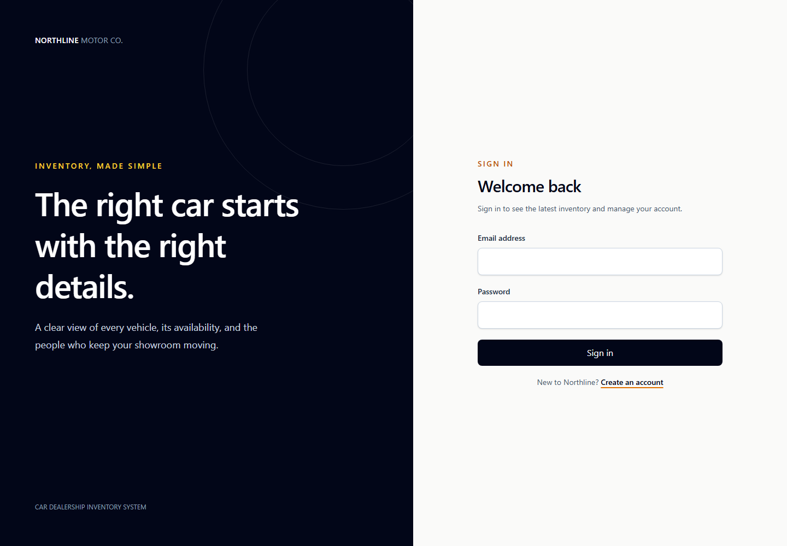
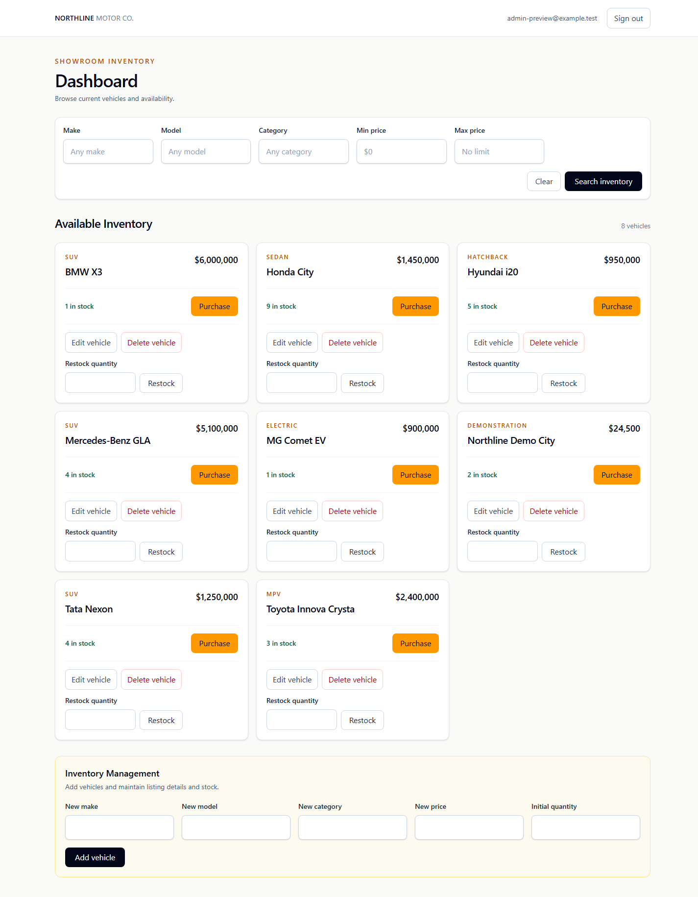

# Car Dealership Inventory System

A full-stack inventory application for browsing and managing dealership
vehicles. Customers can register, sign in, search inventory, and purchase one
unit at a time. Administrators can create and update vehicles, delete listings,
and restock inventory.

## Architecture

- `backend/` is an ESM Node.js/TypeScript application. Express exposes the
  HTTP API; Zod validates configuration and requests; `pg` connects to
  PostgreSQL. Routes call service functions for authentication and inventory
  operations. `app.ts` exports the application without opening a network
  listener; `server.ts` starts the API for development.
- `backend/migrations/` contains versioned SQL schema migrations. The
  migration runner stores checksums and serializes migration execution.
- `frontend/` is a React/TypeScript single-page application built with Vite.
  React Router handles routes, an authentication provider owns the session,
  and a typed API client communicates with the backend. Inventory UI
  components receive data and callbacks; API requests remain in the dashboard
  and API client.
- `docker-compose.yml` starts local PostgreSQL with a named persistent volume
  and creates a separate test database during first-time volume initialization.

## Data model

- `users` has normalized unique email addresses, Argon2 password hashes, and a
  database constraint restricting roles to `USER` or `ADMIN`.
- `vehicles` stores nonnegative `NUMERIC(12,2)` prices and nonnegative integer
  quantities. Listing queries include vehicles whose quantity is zero.
- `purchases` records the buyer, purchase time, vehicle make/model/price
  snapshots, and a nullable vehicle reference. Deleting a vehicle sets that
  reference to `NULL` while preserving the useful purchase snapshots.
- Indexes support case-insensitive make/model/category filtering and purchase
  history lookups by customer or vehicle.

## Technology choices

| Area | Technology | Purpose |
| --- | --- | --- |
| API | Node.js, TypeScript, Express | Typed HTTP service and routing |
| Database | PostgreSQL, `pg` | Persistent relational data and transactional stock changes |
| Validation/security | Zod, Helmet, CORS | Input/config validation, response headers, local SPA access |
| Authentication | Argon2, JSON Web Token | Password hashing and expiring signed bearer tokens |
| Frontend | React, TypeScript, Vite, Tailwind CSS | Responsive SPA and utility styling |
| Routing | React Router | Login, registration, and dashboard routes |
| Tests | Vitest, Supertest, React Testing Library | Backend HTTP/database integration and frontend behavior tests |

## Prerequisites

- Git
- Node.js 22.12 or newer and npm
- Docker Desktop or Docker Engine with the Docker Compose plugin
- An available local TCP port 5432 for PostgreSQL, 3000 for the API, and 5173
  for Vite

## Fresh-clone setup

Run these commands from a terminal. On Windows Command Prompt or PowerShell,
use `npm.cmd` instead of `npm` if the shell blocks `npm.ps1`.

1. Clone the repository and create the local environment file:

   ```sh
   git clone https://github.com/meesha106/car-dealership-inventory.git
   cd car-dealership-inventory
   cp .env.example .env
   ```

   On Windows PowerShell, use `Copy-Item .env.example .env`. Edit `.env` and
   replace all example credentials/secrets. Set `POSTGRES_PASSWORD` to the
   same password embedded in both database URLs. The example uses URL-safe
   characters; percent-encode any reserved characters in a custom password.
   Generate a JWT secret with at least 32 characters, for example:

   ```sh
   node -e "console.log(require('node:crypto').randomBytes(32).toString('hex'))"
   ```

   Keep `.env` local and untracked.

2. Start PostgreSQL and wait for its health check:

   ```sh
   docker compose up -d --wait
   ```

   Compose reads `POSTGRES_PASSWORD` from the repository-root `.env`. The
   first initialization creates the `car_dealership` database and the
   `car_dealership_test` database. Both persist in the `postgres_data` named
   volume. The test runner uses `TEST_DATABASE_URL` and rejects a database
   identity that matches `DATABASE_URL`.

3. Install the locked dependencies:

   ```sh
   cd backend
   npm ci
   cd ../frontend
   npm ci
   cd ..
   ```

4. Apply both schemas and create the initial administrator:

   ```sh
   cd backend
   npm run db:migrate
   npm run db:migrate:test
   npm run seed:admin
   ```

   Set `ADMIN_SEED_EMAIL` and `ADMIN_SEED_PASSWORD` in the root `.env` before
   seeding. The seed requires a password of at least 12 characters, stores an
   Argon2 hash, and safely creates or updates that address as ADMIN. Rerunning
   it updates the same account.

## Environment variables

| Variable | Used by | Description |
| --- | --- | --- |
| `POSTGRES_PASSWORD` | Docker Compose | Password for the local `car_dealership` PostgreSQL role; must match both connection URLs |
| `DATABASE_URL` | Backend | Development PostgreSQL connection URL |
| `TEST_DATABASE_URL` | Backend tests and test migrations | Separate PostgreSQL test database connection URL |
| `PORT` | Backend | HTTP listen port; defaults to 3000 |
| `JWT_SECRET` | Backend | Secret for signing and verifying expiring authentication tokens; provide at least 32 characters |
| `FRONTEND_ORIGIN` | Backend | Allowed browser origin for CORS; defaults to `http://localhost:5173` |
| `ADMIN_SEED_EMAIL` | `seed:admin` | Initial administrator email |
| `ADMIN_SEED_PASSWORD` | `seed:admin` | Initial administrator password; at least 12 characters |
| `VITE_API_URL` | Frontend (optional) | API base URL; defaults to `http://localhost:3000`. If overridden, define it in `frontend/.env.local`. |

The backend reads the repository-root `.env`. Vite reads its own environment
file in `frontend/`; the default API URL needs no extra frontend configuration.
Never put populated local environment files in version control.

## Run locally

Start the backend in one terminal:

```sh
cd backend
npm run dev
```

Start the frontend in a second terminal:

```sh
cd frontend
npm run dev -- --host localhost
```

Open `http://localhost:5173`. Use `localhost` rather than `127.0.0.1` with the
default CORS configuration. The backend health check is `GET
http://localhost:3000/health`.

## API

All vehicle routes require a valid bearer token. USER and ADMIN can list,
search, and purchase. Vehicle creation, update, deletion, and restocking are
ADMIN-only. Errors use a JSON object with `error.code` and `error.message`.

| Method and path | Access | Success | Common errors |
| --- | --- | --- | --- |
| `POST /api/auth/register` | Public; always creates USER | `201` with public user and token | `400` invalid email/password; `409` duplicate email |
| `POST /api/auth/login` | Public | `200` with public user and token | `400` invalid input; `401` invalid credentials |
| `GET /api/vehicles` | USER, ADMIN | `200` with vehicle list; includes zero-stock vehicles | `401` missing/invalid/expired token |
| `GET /api/vehicles/search` | USER, ADMIN | `200` with filtered list | `400` invalid filters or min price greater than max; `401` |
| `POST /api/vehicles` | ADMIN | `201` with created vehicle | `400` invalid fields; `401`; `403` USER |
| `PUT /api/vehicles/:id` | ADMIN | `200` with updated vehicle; quantity is unchanged | `400` invalid ID/body; `401`; `403`; `404` |
| `DELETE /api/vehicles/:id` | ADMIN | `200` confirmation | `400` invalid ID; `401`; `403`; `404` |
| `POST /api/vehicles/:id/purchase` | USER, ADMIN | `201` with purchase and updated vehicle | `400` invalid ID; `401`; `404`; `409` out of stock |
| `POST /api/vehicles/:id/restock` | ADMIN | `200` with updated vehicle | `400` invalid ID or nonpositive/noninteger quantity; `401`; `403`; `404` |

Example registration and login (supply real values locally; do not save a
token in this file). In Windows PowerShell, use `curl.exe` rather than its
`curl` alias:

```sh
curl -X POST http://localhost:3000/api/auth/register \
  -H "Content-Type: application/json" \
  -d '{"email":"customer@example.test","password":"replace-with-a-local-password"}'

curl -X POST http://localhost:3000/api/auth/login \
  -H "Content-Type: application/json" \
  -d '{"email":"customer@example.test","password":"replace-with-a-local-password"}'
```

Set `TOKEN` to the returned token only in your local shell, then use it for
customer inventory/search/purchase requests:

```sh
curl http://localhost:3000/api/vehicles \
  -H "Authorization: Bearer $TOKEN"

curl "http://localhost:3000/api/vehicles/search?make=Honda&minPrice=10000&maxPrice=30000" \
  -H "Authorization: Bearer $TOKEN"

curl -X POST http://localhost:3000/api/vehicles/<vehicle-id>/purchase \
  -H "Authorization: Bearer $TOKEN" \
  -H "Content-Type: application/json" \
  -d '{}'
```

Administrator requests use the same bearer header:

```sh
curl -X POST http://localhost:3000/api/vehicles \
  -H "Authorization: Bearer $TOKEN" \
  -H "Content-Type: application/json" \
  -d '{"make":"Honda","model":"Civic","category":"Sedan","price":24500,"quantity":3}'

curl -X PUT http://localhost:3000/api/vehicles/<vehicle-id> \
  -H "Authorization: Bearer $TOKEN" \
  -H "Content-Type: application/json" \
  -d '{"make":"Honda","model":"Civic","category":"Sedan","price":23900}'

curl -X DELETE http://localhost:3000/api/vehicles/<vehicle-id> \
  -H "Authorization: Bearer $TOKEN"

curl -X POST http://localhost:3000/api/vehicles/<vehicle-id>/restock \
  -H "Authorization: Bearer $TOKEN" \
  -H "Content-Type: application/json" \
  -d '{"quantity":5}'
```

Purchase is an atomic conditional stock decrement and purchase-history insert
inside one PostgreSQL transaction. Vehicle deletion uses `ON DELETE SET NULL`
for purchase references; purchase make/model/price snapshots remain available.

### Vehicle-management permission decision

The assignment labels add/update as “protected” and explicitly describes
delete/restock as “Admin only.” This implementation restricts add, update,
delete, and restock to ADMIN as a documented product decision. Backend
middleware independently enforces these permissions; hiding controls in the
SPA is not the security boundary.

## Tests and checks

Start PostgreSQL and apply the test migration before backend integration tests.
From `backend/`:

```sh
npm test
npm run typecheck
npm run build
npm run coverage
```

From `frontend/`:

```sh
npm test
npm run typecheck
npm run build
```

Backend integration tests use the separate PostgreSQL test database. Frontend
tests use request stubs for UI behavior; they do not replace live API data in
the application. The latest verified results and coverage are recorded in
[TEST_REPORT.md](./TEST_REPORT.md).

## Screenshots

These are genuine screenshots captured from the running local React app and
backend on 24 October 2026. The dashboard capture used a short-lived signed
ADMIN preview session (not a seeded/login account) and includes one temporary
demo vehicle added through the API for the screenshot; that fixture was
removed after capture.

**Login**



**ADMIN inventory dashboard**



## My AI Usage

AI assistance was used during staged implementation to discuss the build order,
draft and refine application code, develop tests, and review requirements.
Changes were checked against the repository and verified with the commands
recorded in [TEST_REPORT.md](./TEST_REPORT.md). This description is a summary,
not a raw chat transcript. See the note below about the outstanding raw-log
requirement.

## Assignment submission status

The source, current tests, setup documentation, test report, and genuine
screenshots are present in the working tree. The staged red-green-refactor
commit history and complete raw AI chat logs/public links have not been
verified as complete. Review the Git history and `PROMPTS.md` before treating
the repository as a finished submission.
